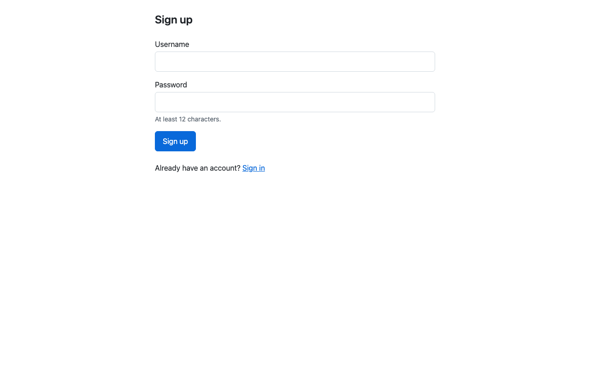
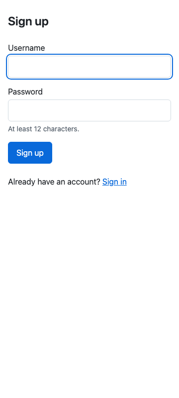
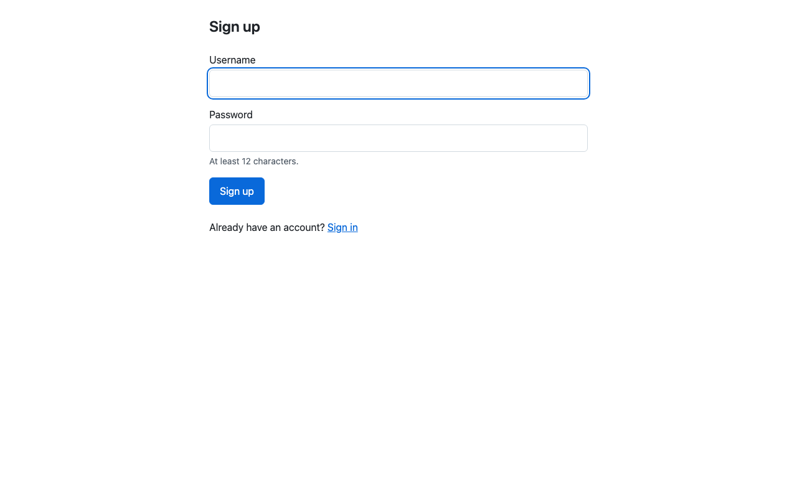
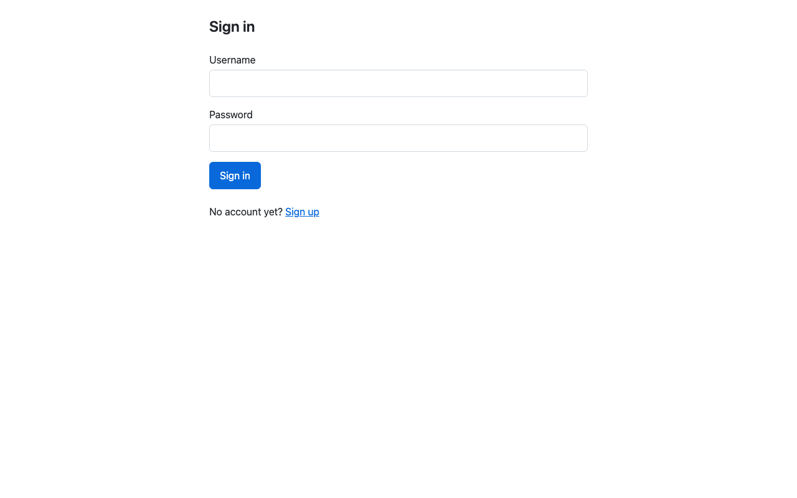
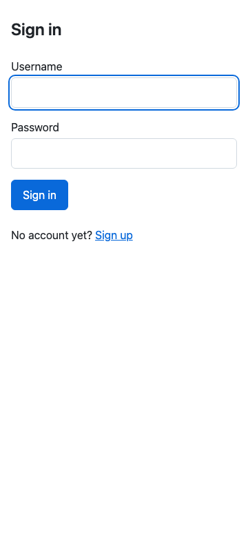
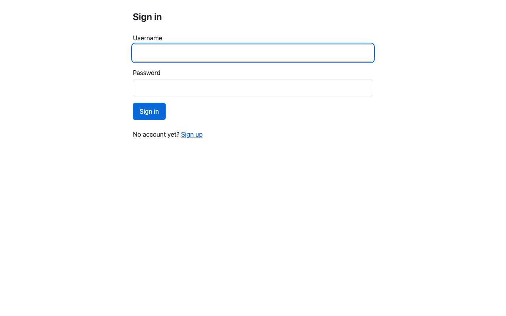
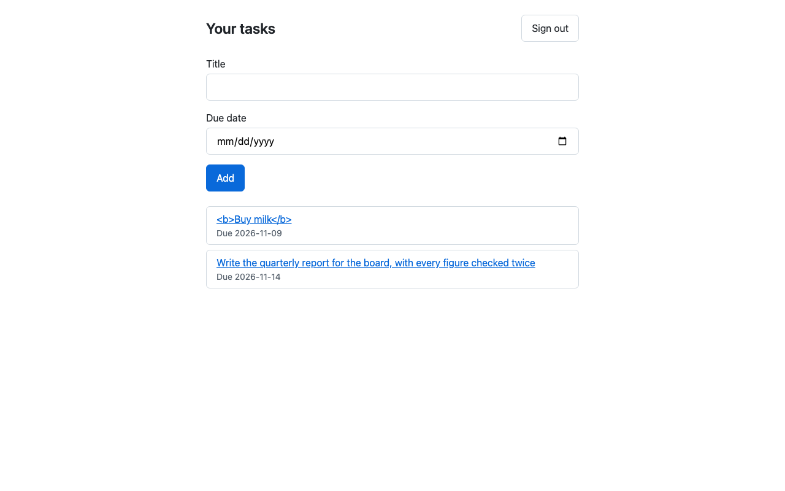
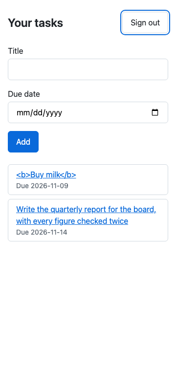
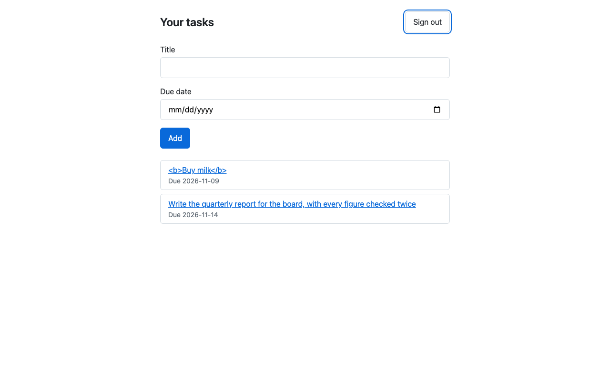

# Acceptance guide: task manager, delivery 1

Based on requirements version 2. Delivery report: [delivery-report.md](delivery-report.md).

## Summary

Delivery 1 lets people sign up, sign in, add tasks, and see their own private list. Changing, deleting, and hiding tasks come in delivery 2.
Our tester checked how the pages look on a phone and on a computer; their screenshots are under "The screens". There are 5 "Must check" items and no optional ones. The check takes about 20 minutes.

## What you need to do

> [!IMPORTANT]
> - Look at the screenshots under "The screens" (about 2 minutes), do the 5 "Must check" items below (about 20 minutes), write the result of each, and tell us whether you accept delivery 1.

## The screens

- Covers: AC-10 to AC-13 (R-10)
- Result: <as expected | not as expected: what you see>

Our tester opened each page in a web browser, as narrow as a phone (360 px) and as wide as a computer screen (1280 px), and measured it: each label sits above its field with space between them, buttons have the same height and do not overlap anything, nothing runs off the side, and the Tab key marks where you are. Everything passed. Here is what they saw; you can also look at the pages yourself when you do the checks below.

### Sign-up page

### Sign-in page

### Task list

## Before you start

1. Start the app on your computer by following "Try it on your computer" in the project's README. It takes one command.
2. Open `http://localhost:8080` in your web browser.
3. Have four different usernames ready, one for each test account below. Anyone can see whether a username is taken, so do not use a private name.

## Must check

### Check 1: Another person cannot see or open your tasks

- Covers: AC-4 (R-7)
- Result: <pass | fail: what happened | not checked>

Steps:

1. Sign up with your first username, and add a task called "Private task".
2. Click the task, and copy the address shown in the browser's address bar.
3. Sign out.
4. Sign up with your second username.
5. Look at the task list.
6. Paste the copied address into the address bar and open it.

Expected result: in step 5 the list is empty: "Private task" is not there. In step 6 the page says "Task not found".

### Check 2: Wrong passwords block signing in for a while

- Covers: AC-7 (R-8)
- Result: <pass | fail: what happened | not checked>

Steps:

1. Sign out.
2. Sign in with your first username and a wrong password. Do this 5 times.
3. Sign in with the right password.

Expected result: in step 3 you are not signed in, and the page says when you can try again, 15 minutes after the fifth wrong password.

### Check 3: An account works from sign-up to sign-in

- Covers: AC-1 (R-1, R-2)
- Result: <pass | fail: what happened | not checked>

Steps:

1. Sign up with your third username and a password of 12 or more characters.
2. Sign out.
3. Open `http://localhost:8080/tasks`.
4. Sign in with the same username and password.

Expected result: in step 3 you see the sign-in page, not a task list. After step 4 you see your task list.

### Check 4: A new task appears in your list, exactly as typed

- Covers: AC-3 (R-3, R-4)
- Result: <pass | fail: what happened | not checked>

Steps:

1. Sign in.
2. Add a task with the title `<b>Buy milk</b>` and tomorrow's date as the due date.

Expected result: the task appears in your list with the title `<b>Buy milk</b>`, including `<b>` and `</b>`, not in bold, and with tomorrow's date.

### Check 5: A short password and a username with `@` are refused

- Covers: AC-2, AC-9 (R-1)
- Result: <pass | fail: what happened | not checked>

Steps:

1. Sign out, and sign up with your fourth username and the 11-character password `abcdefghijk`.
2. Sign up with the username `me@example.com` and a password of 12 or more characters.

Expected result: neither step creates an account. In step 1 the page says the password must be at least 12 characters long; in step 2 it says a username cannot contain `@`.

## Optional

None.

## If a check fails

Write what you did and what you saw in the "Result" line, and tell us. We fix it and send you only the checks affected by the fix.
