# Test report: task manager, delivery 1

Based on requirements version 2. Acceptance guide: [acceptance-guide.md](acceptance-guide.md). Delivery report: [delivery-report.md](delivery-report.md).

## Summary

Our tester checked all 10 acceptance criteria of delivery 1, and all of them passed. Each one below says how it was checked and shows what the tester saw.
Not checked: the app in Firefox and Safari, and signing in on your own server over HTTPS. Changing, deleting, and hiding tasks (R-5, R-6, R-9) come in delivery 2.

## What you need to do

> [!IMPORTANT]
> - Read how each criterion was checked and look at the screenshots (about 20 minutes). You do not need to run anything. If something is not as you expect, say so when you answer the acceptance guide.

## How we tested

- **Who**: an independent tester, who wrote the tests from the requirements only, without seeing the code.
- **What**: the version of 2026-11-08 (`9b02d4f`), the final one of delivery 1.
- **How**: the tester started the app as the programmer's instructions say, and used its pages in a web browser (Chrome's engine) as a person does: opening pages, typing, and pressing buttons, on a screen as wide as a computer's (1280 px). For how the pages look, they also opened every page as narrow as a phone (360 px). Where a page cannot show something, such as a block that ends after 15 minutes, the tests also asked the app directly, with a clock they can move.
- **Automated checks**: the programmer's and the tester's tests ran again on the final version, with the code style checks, and passed.

## Results

| Requirement | Criterion | Result | Evidence |
|---|---|---|---|
| R-1: Sign up, R-2: Sign in and sign out | AC-1: An account works from sign-up to sign-in | passed | [2 screenshots](#ac-1-an-account-works-from-sign-up-to-sign-in) |
| R-1: Sign up | AC-2: A short password is refused | passed | [1 screenshot](#ac-2-a-short-password-is-refused) |
| R-3: Add a task, R-4: See your tasks | AC-3: A new task appears in your list | passed | [1 screenshot](#ac-3-a-new-task-appears-in-your-list) |
| R-7: Your tasks are private | AC-4: Another person cannot see or open your tasks | passed | [2 screenshots](#ac-4-another-person-cannot-see-or-open-your-tasks) |
| R-8: Limit wrong passwords | AC-7: Wrong passwords block signing in for a while | passed | [1 screenshot](#ac-7-wrong-passwords-block-signing-in-for-a-while) |
| R-1: Sign up | AC-9: A username with `@` is refused | passed | [1 screenshot](#ac-9-a-username-with--is-refused) |
| R-10: The screens are tidy | AC-10: Labels sit with their fields | passed | [The screens](#the-screens) |
| R-10: The screens are tidy | AC-11: Buttons line up | passed | [The screens](#the-screens) |
| R-10: The screens are tidy | AC-12: The pages fit a phone | passed | [The screens](#the-screens) |
| R-10: The screens are tidy | AC-13: You can see where you are with the keyboard | passed | [The screens](#the-screens) |

## How each criterion was checked

### AC-1: An account works from sign-up to sign-in

- Covers: R-1, R-2
- Result: passed

How we checked it:

1. Opened the start page, chose "Sign up", and signed up with a new username and a 14-character password.
2. Chose "Sign out".
3. Opened the address of the task list (`/tasks`).
4. Signed in with the same username and password.

What we saw: after step 3, the sign-in page instead of a task list. After step 4, the task list, "Your tasks", still empty.

### AC-2: A short password is refused

- Covers: R-1
- Result: passed

How we checked it:

1. Opened the sign-up page.
2. Signed up with a new username and the 11-character password `abcdefghijk`.
3. Tried to sign in with that username and password.

What we saw: in step 2, the page stayed on "Sign up" and said "The password must be at least 12 characters long." under the password. In step 3, signing in failed: no account had been created.

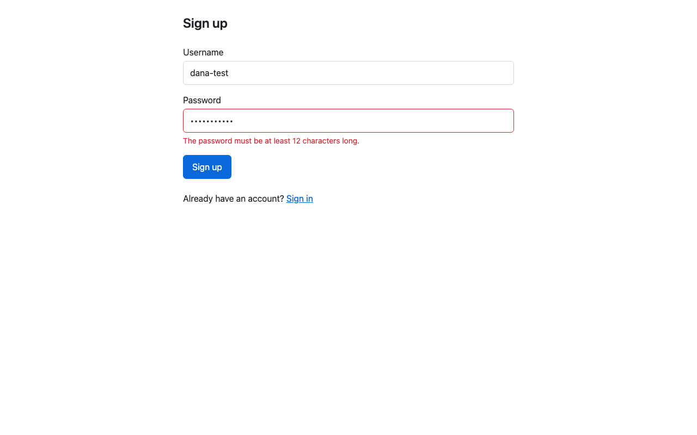

### AC-3: A new task appears in your list

- Covers: R-3, R-4
- Result: passed

How we checked it:

1. Signed up and signed in.
2. Typed `<b>Buy milk</b>` as the title, chose 2026-11-09 as the due date, and chose "Add".
3. Reloaded the page.

What we saw: the list showed the task with the title `<b>Buy milk</b>`, with `<b>` and `</b>` shown as typed and nothing in bold, and "Due 2026-11-09", before and after reloading.

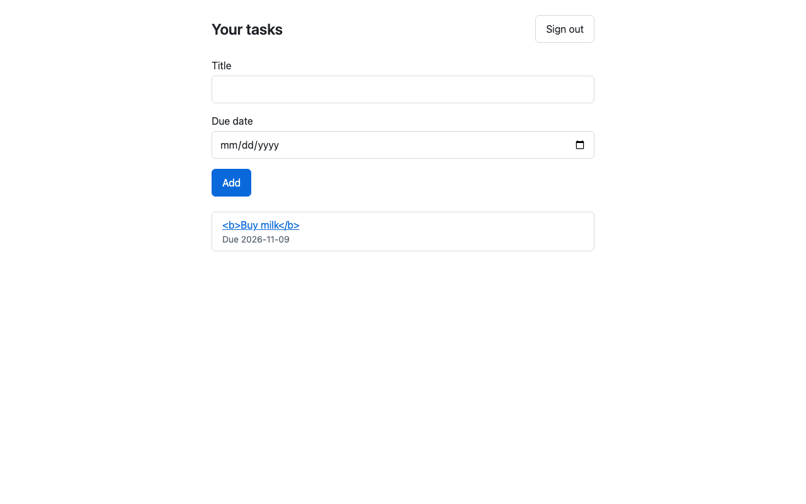

### AC-4: Another person cannot see or open your tasks

- Covers: R-7
- Result: passed

How we checked it:

1. Signed up as a first account, and added the task "Private task".
2. Opened the task, and copied the address the browser showed.
3. Signed out, and signed up as a second account.
4. Looked at the task list.
5. Opened the copied address.

What we saw: in step 4, the second account's list was empty: "No tasks yet." In step 5, the page said "Task not found". The tests also asked the app directly, as the second account, for its list and for the first account's task: the list was empty, and the app answered that there is no such task.

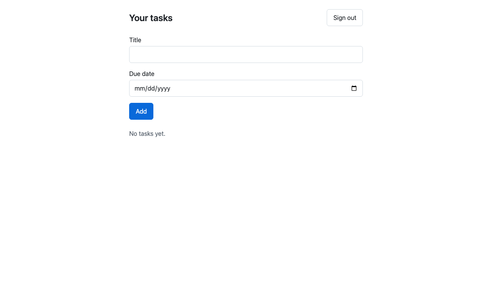

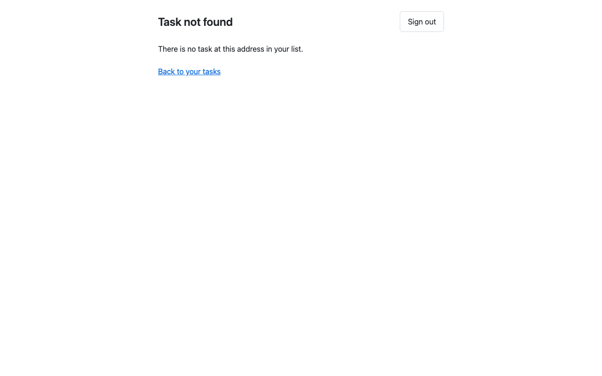

### AC-7: Wrong passwords block signing in for a while

- Covers: R-8
- Result: passed

How we checked it:

1. Signed up, and signed out.
2. Signed in with that username and a wrong password, 5 times.
3. Signed in with the right password.
4. Asking the app directly, with a clock the test sets, did the same on another account at 14:20, then tried the right password at 14:34 and at 14:35.
5. Before step 4, signed in to that account somewhere else, and used it during the block.

What we saw: in step 3, the page stayed on "Sign in" and said "Too many wrong passwords. You can try again at 14:35.", 15 minutes after the fifth wrong password. In step 4, signing in was refused at 14:34 and worked at 14:35. In step 5, the account that was already signed in kept working during the block.

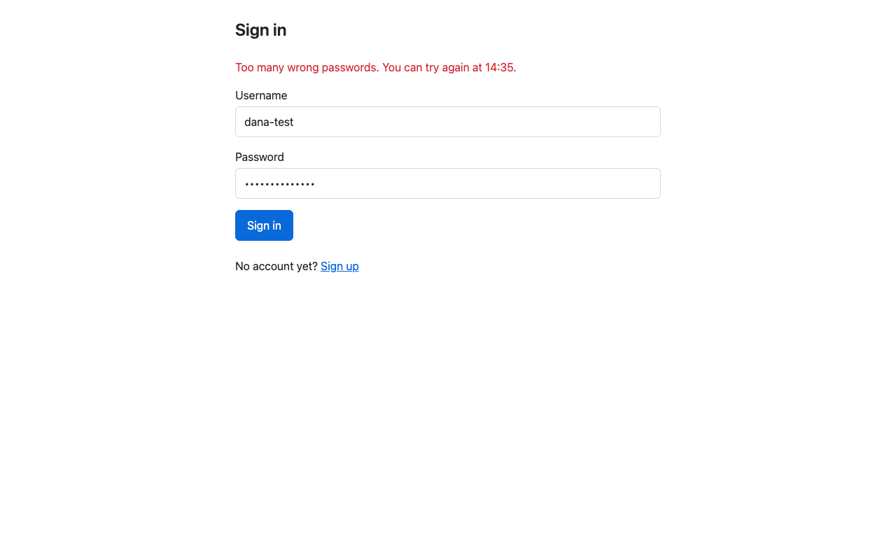

### AC-9: A username with `@` is refused

- Covers: R-1
- Result: passed

How we checked it:

1. Opened the sign-up page.
2. Signed up with the username `me@example.com` and a 14-character password.
3. Tried to sign in with them.

What we saw: in step 2, the page stayed on "Sign up" and said "A username cannot contain @." under the username. In step 3, signing in failed: no account had been created.

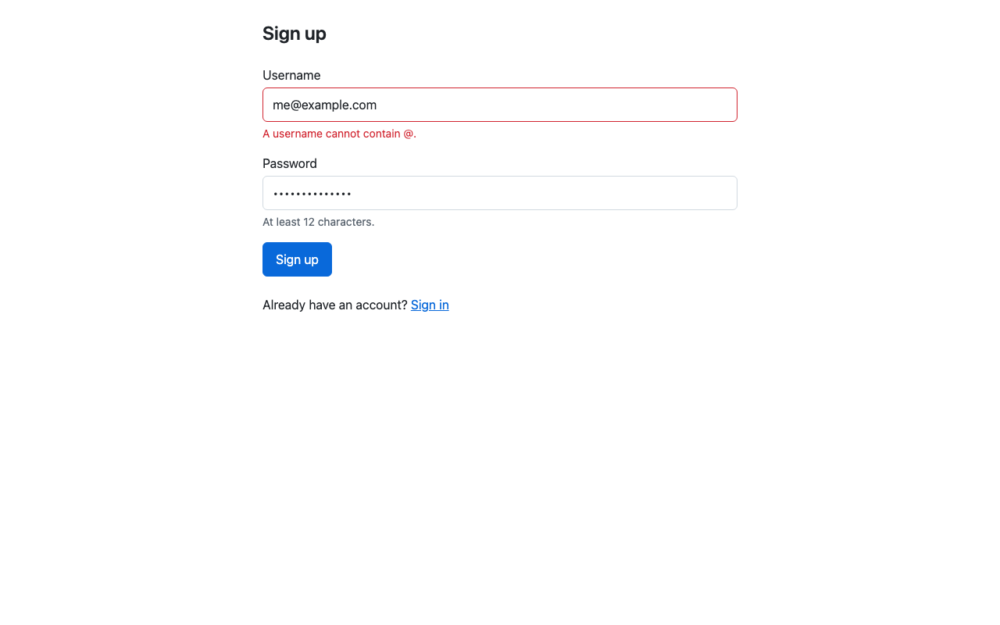

### AC-10: Labels sit with their fields

- Covers: R-10
- Result: passed

How we checked it: opened the sign-up page, the sign-in page, and the task list, as narrow as a phone (360 px), as wide as a computer screen (1280 px), and on both sides of the width where the layout changes (599 and 600 px), and measured where each label is.

What we saw: every label is above its field, at the same left edge, with a small space between them (4 px) and more space before the next field (16 px). From the screenshots, it is clear which label belongs to which field. See [The screens](#the-screens).

### AC-11: Buttons line up

- Covers: R-10
- Result: passed

How we checked it: on the same pages and widths, measured the height of every button and whether it overlaps anything.

What we saw: every button is the same height (44 px), and none overlaps another button or any text. From the screenshots, the buttons of each form line up on the left under its fields, and the main button stands out. The buttons of each task (change, delete) come in delivery 2 and are checked then. See [The screens](#the-screens).

### AC-12: The pages fit a phone

- Covers: R-10
- Result: passed

How we checked it: on the same pages and widths, checked whether the page can be scrolled sideways and whether anything ends past its right edge.

What we saw: no page scrolls sideways, and nothing runs off the side. From the screenshots, no text or button is cut off on a phone, and a long task title wraps inside its row. See [The screens](#the-screens).

### AC-13: You can see where you are with the keyboard

- Covers: R-10
- Result: passed

How we checked it: on the same pages and widths, moved through every link, field, and button with the Tab key, and checked that each is marked.

What we saw: each one shows a clear blue outline around it (2 px), the date field included. See the screenshots "after pressing Tab once" in [The screens](#the-screens).

## The screens

Our tester opened each page in a web browser, as narrow as a phone (360 px) and as wide as a computer screen (1280 px), and measured it: each label sits above its field with space between them, buttons have the same height and do not overlap anything, nothing runs off the side, and the Tab key marks where you are. These screenshots are the evidence for AC-10 to AC-13.

### Sign-up page

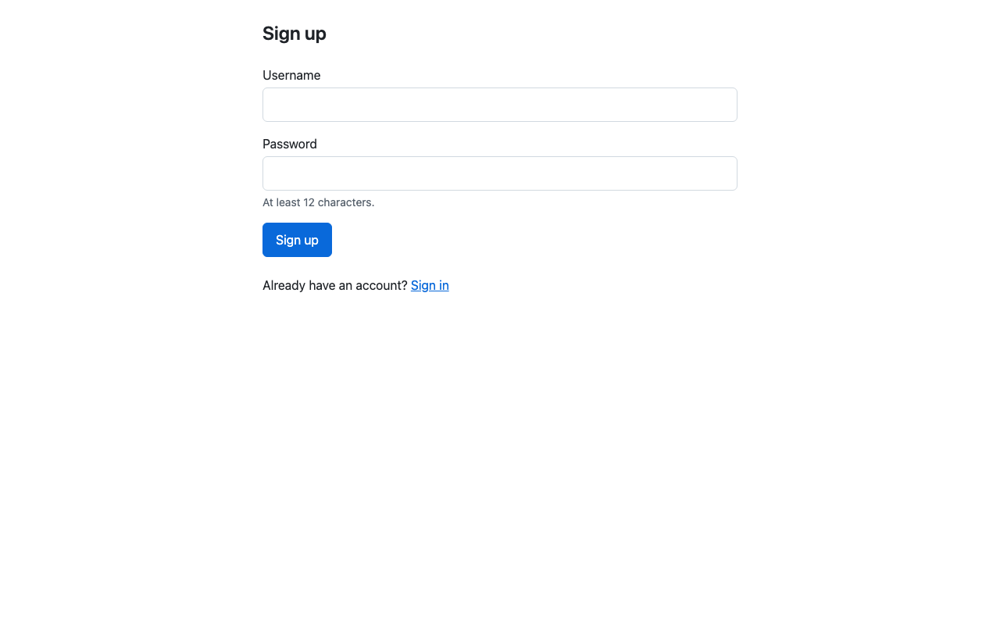

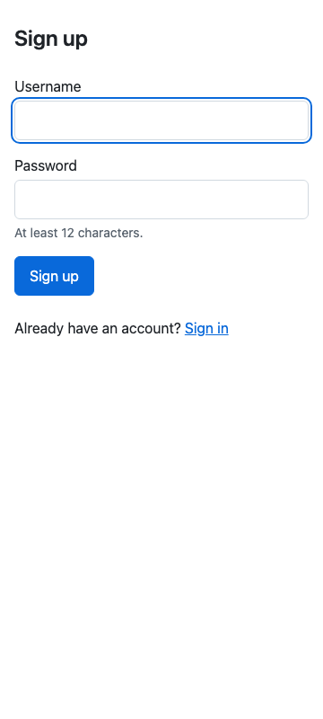

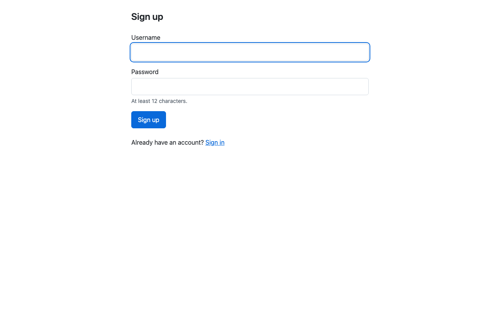

### Sign-in page

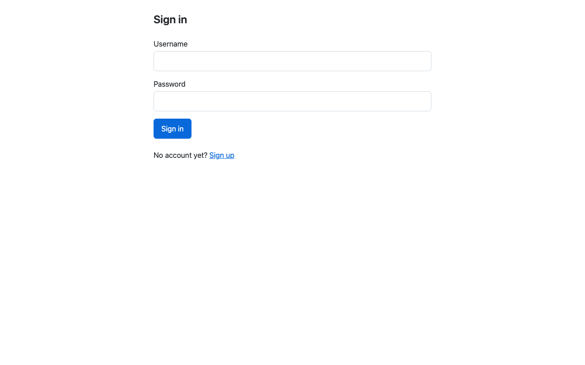

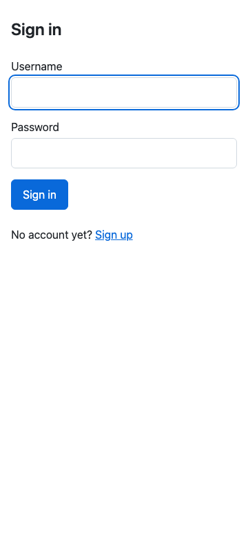

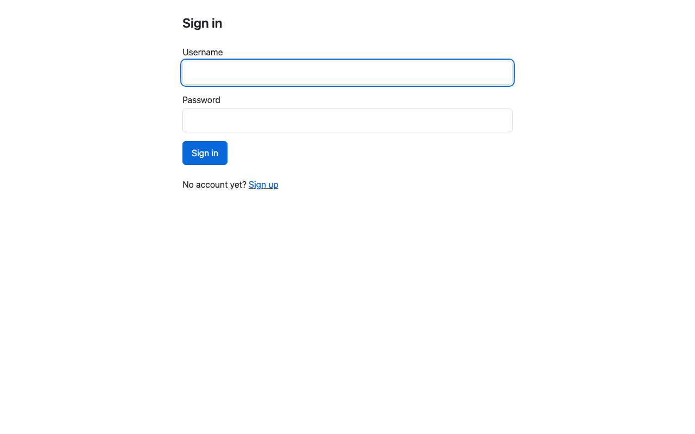

### Task list

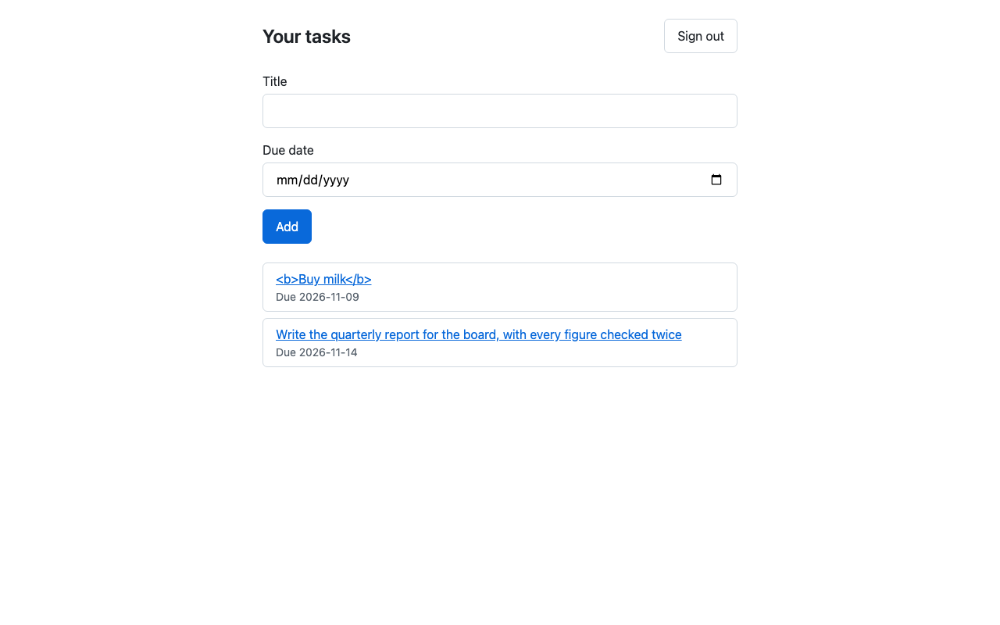

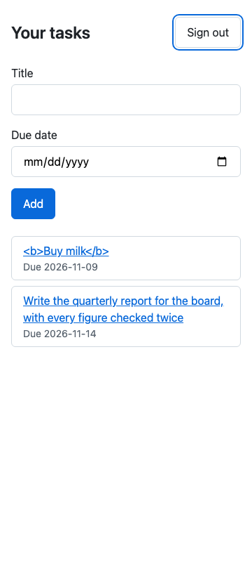

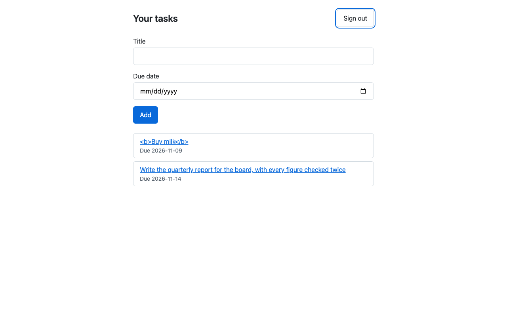

## What we did not check

- The pages in Firefox and Safari: our tester used Chrome's engine only. You can open the pages in the browser you use, as the acceptance guide says under "Try it yourself".
- Signing in on your own server over HTTPS: the tests ran on one computer, without HTTPS. Signing in works only over HTTPS (or on the computer the app runs on), on purpose, to protect it. When you put the app on your server with HTTPS, sign in once to check it.
